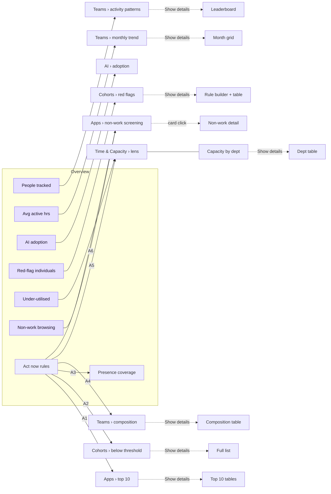

# Chameleon 360 — Logic, Formulas & Tab Links

How every number on the We360 Executive Dashboard is calculated, which settings drive it, and how the tabs connect.
Code references point to the file that implements each piece, so the document and the dashboard can be checked against each other.

---

## Contents

1. [Data flow](#1-data-flow)
2. [Base definitions](#2-base-definitions)
3. [Global filters](#3-global-filters)
4. [Shared settings](#4-shared-settings)
5. [Tab by tab](#5-tab-by-tab)
   - [Overview](#51-overview)
   - [Teams](#52-teams)
   - [Time & Capacity](#53-time--capacity)
   - [Cohorts](#54-cohorts)
   - [AI adoption](#55-ai-adoption)
   - [Apps & websites](#56-apps--websites)
   - [Data & settings](#57-data--settings)
6. [Decision rules (Act now / Opportunity / Keep as is)](#6-decision-rules)
7. [How the tabs are linked](#7-how-the-tabs-are-linked)
8. [Configuration reference](#8-configuration-reference)

---

## 1. Data flow

```
data/<client-id>/                     src/data/loadDataset.ts        src/data/adapter.ts
  employees.csv        ─┐
  daily_activity.csv   ─┼─► parse CSV ─► merge client_config.json ─► map columns ─► Dataset
  app_usage.csv        ─┤                 over default config         (COLUMNS)
  client_config.json   ─┘

Dataset ─► Scope (period + team filter) ─► PersonStat per person ─► every chart, table, KPI and rule
           src/lib/metrics.ts makeScope()    personStats()
```

- **Client chosen by:** `?client=<id>` in the URL → `VITE_CLIENT` → first folder under `data/`.
- **Nothing is hard-coded per client.** Pages only read computed values; client differences live in the CSVs and `client_config.json`.
- **Excluded accounts** (`Excluded = Yes`, or names containing "test"/"admin" when the column is missing) are removed before any calculation.

### Raw tables

| Table | Grain | Key fields |
|---|---|---|
| Employee | one row per person | id, name, department, team, joinDate, excluded |
| DailyRecord | one row per person per working day | present, onlineSec, activeSec, productiveSec, neutralSec, unproductiveSec, spanSec |
| AppUsageRecord | one row per person per app/URL per bucket (day / week / month) | name, kind (app/url), productivity, category, activeSec |

---

## 2. Base definitions

### Time measures (per day, from `daily_activity.csv`)

```
Working (punched in) = Punch span                      ← punch-in to punch-out
Online               = logged-in time
Active               = keyboard / mouse activity  (part of Online)
Idle                 = Online − Active
Break / offline      = Span − Online
Productive / Neutral / Unproductive = Active split by the client's tagging
Active               = Productive + Neutral + Unproductive
```

This follows the design-system nesting: *Working = Online + Break + Offline · Online = Active + Idle · Active = Productive + Unproductive + Neutral.*

### Present day

A day counts as **present** when the ledger says `Present = Yes` (or, if that column is missing, when online time > 0).

**Every average is per present day.** Leave, holidays and days with missing agent data are never counted as zero hours.

### Per-person statistics — `personStats()`

For each person over the selected period:

| Value | Formula |
|---|---|
| presentDays | count of present days |
| trackedDays | count of ledger rows (present or not) |
| avg active / productive / online | Σ seconds on present days ÷ presentDays ÷ 3600 |
| avg idle | avg online − avg active |
| productivePct | Σ productive ÷ Σ active × 100 |
| unproductiveHrs | Σ app-usage hours tagged *unproductive* |
| topUnproductive | the unproductive app/URL with the most hours |
| nonWorkHrs | Σ app-usage hours in the client's `nonWorkCategories` |
| catHrs[c] | Σ app-usage hours in category *c* (every category) |
| aiHrs | Σ app-usage hours on names matching `aiTools` patterns |
| daysByMetric | the list of daily hours (active / productive / online) — used for "% of days" rules |

**Reliable people** are those with `presentDays ≥ minPresentDaysForLists` (default **15**). Individual lists use them so one-day blips do not dominate.

### Group statistics — `groupStats()`

Groups are departments, teams, or — when a single team is selected — **individual people**.

| Value | Formula |
|---|---|
| avg (active / productive / online) | Σ group seconds ÷ Σ group present days ÷ 3600 (person-day weighted) |
| prodPct / neutralPct / unprodPct | Σ category seconds ÷ (Σ productive + neutral + unproductive) × 100 |
| meeting | people whose own average meets the threshold (e.g. active < 3h) |
| meetingPct | meeting ÷ people in group × 100 |

Groups smaller than `minGroupSize` (default **3**) are hidden, except in per-person mode.

### Coverage — `coverage()`

```
Coverage % = present person-days ÷ tracked person-days × 100
```

Tracked person-days = people × working days they were employed (people who joined mid-period count from their join date).

### Formatting conventions

- `h` = hours. `—` means no value.
- `*` after a month label (e.g. `Mar*`) = the month is only partly inside the selected period.

---

## 3. Global filters

Every page header has two columns: the title and description on the left, the filters on the right (with the date range
and working days under them). The filters apply to **every tab and every detail page**.

- **Teams tab:** the main page shows only the period filter and always compares all teams. The team filter appears on its
  detail pages.

### Period — Last 1 month / 3 months / 6 months / 1 year

```
end   = latest date in the data
start = end − N months + 1 day          (clipped to the first date in the data)
working days = distinct ledger dates between start and end
```

- If the period reaches before the data starts, the top bar says *"only <date> onward is available"*.
- App usage is stored in buckets (monthly in the demo). A bucket is included when its month overlaps the period.
- **Trend charts switch to weekly** when the period has ≤ 31 working days.

### Team — All teams / one team

- Narrows people, daily rows and app usage to that team.
- **Per-person mode:** with one team selected, every chart or table that would compare departments compares **people** instead:

| View | All teams | One team |
|---|---|---|
| Teams · activity patterns | departments | people (coral = below baseline) |
| Teams · leaderboard | departments / teams | people |
| Teams · composition | departments | people |
| Teams · monthly detail grid | department × month | person × month |
| Time & Capacity · by department | departments | people |
| Cohorts · red flags chart | flagged count per department | each flagged person's avg active |
| Cohort member page | members per department | each member's first-rule value |

### Category — All categories / one category *(Apps & websites tab only)*

Re-scopes the Apps & websites tab to a single usage category. It is set from the top bar or by clicking a category bar or label.

---

## 4. Shared settings

Some settings are held globally, so the same definition is used everywhere it appears.

| Setting | Set on | Also drives |
|---|---|---|
| **Activity threshold** (default *active < 3h/day*) | Teams · activity patterns | Teams baseline, leaderboard ranking and threshold columns |
| **Capacity benchmark and band** (default *online 7h ± 10%*) | Time & Capacity | Overview "Under-utilised workforce" card, Act now rule "underutilised > 50%", Opportunity "healthy < 50%", overburdened-days rules |
| **Red-flag rules** (default *active < 2h and 50+ present days*) | Cohorts · Red flags detail | Overview "Red-flag individuals" card |
| **Cohorts** (presets from config) | Cohorts tab | sidebar-independent; evaluated live on period + team |

---

## 5. Tab by tab

### 5.1 Overview

**Purpose:** a snapshot of the whole workforce, plus what needs action now.

#### KPI cards (3 × 2)

| Card | Formula | Opens |
|---|---|---|
| People tracked | count of non-excluded people with ledger rows in the period | Teams › activity patterns |
| Avg. active hrs / present day | Σ active ÷ Σ present days (all people). Sub-line shows online and productive the same way | Teams › monthly trend |
| AI tool adoption | people with aiHrs > 0 ÷ people tracked × 100 | AI adoption › adoption |
| Red-flag individuals | people matching the red-flag rules (see 5.4) | Cohorts › red flags |
| Under-utilised workforce | reliable people whose average (capacity metric) is **below the capacity band minimum** ÷ reliable people × 100 | Time & Capacity › lens |
| Non-work browsing | Σ hours in non-work categories ÷ Σ all app-usage hours × 100 | Apps & websites › non-work screening |

#### Presence coverage

- **Donut:** present person-days ÷ tracked person-days. Absent days are split by **absence reason** when the ledger has one (e.g. Leave, No activity tracked, Unplanned).
- **Reconciliation line:** *people × working days* vs tracked person-days, explaining any gap from mid-period joiners.
- **People by presence rate**, per person = present days ÷ their tracked days:
  - **90%+** (green)
  - **50–90%** (amber)
  - **under 50%** (coral)

#### Act now (end of page, open by default)

Only the **Act now** decision rules ([section 6](#6-decision-rules)). If none fire, a green *"Nothing needs immediate action"* message is shown.

---

### 5.2 Teams

**Purpose:** how departments (or people) compare, and how the picture moves month to month.

#### Department-wise activity patterns

- **Bars:** group average of the chosen metric (active / productive / online) per present day, sorted low → high.
- **Dashed coral line:** the threshold value (*baseline*).
- **Dark line:** number of people in each department whose own average meets the threshold. Hidden in per-person mode, where bars below the baseline turn coral instead.
- **Controls:** metric, comparison (`<`, `≤`, `>`, `≥`) and hours. These set the **global under-utilised threshold**.

**Show details** opens the larger chart plus the **Team leaderboard**:

| Column | Formula |
|---|---|
| Rank | sorted by the graph's metric, high → low |
| Avg active / productive / online | group averages (selected metric in bold) |
| Idle gap | avg online − avg active |
| Productive % | prodPct |
| People below threshold, % of group | meeting, meetingPct (per-person mode: Yes / No) |
| Highlight | top N rows green, bottom N rows red (N editable, default 5) |

The leaderboard can group by department or by team; in per-person mode it ranks people.

#### Month-wise online, active & productive time

- Per month (or week): Σ seconds ÷ Σ present days, for online, active and productive.
- **Show details** adds:
  - **By-month table:** online, active, productive, idle gap and *Prod. %* (productive ÷ active).
  - **Department (or person) × month grid** for a chosen metric. Cells below the period average are shaded red.

#### Activity & productivity composition

- 100% stacked bar per group: productive % / neutral % / unproductive %.
- **Show details** adds a table with productive and active hours per day. Rows with unproductive > 5% are highlighted.

---

### 5.3 Time & Capacity

**Purpose:** how much of the workforce's capacity is used against a daily benchmark, and how the working day is spent.

#### Benchmark

| Setting | Default (demo) | We360 sample |
|---|---|---|
| Metric | avg **online** hours per present day | online |
| Benchmark *B* | **7h** | 7h |
| Healthy band | B ± 10% = 6.3h – 7.7h | **6.25h – 7.75h** (explicit min / max from the sheet) |

```
Healthy band:  explicit min / max when configured, else min = B × (1 − v), max = B × (1 + v)
               (on the page only ± variance is editable; it sets min = B × (1 − v) and max = B × (1 + v))

Status (per person or group, on its own average per present day):
  value < min        → Underutilised   (coral)
  min ≤ value ≤ max  → Healthy         (teal)
  value > max        → Overburdened    (amber)
```

#### Summary cards

| Card | Formula |
|---|---|
| Average per working day : benchmark | achieved ÷ person-days (absent days count as 0h), shown as *h m : B* |
| Net capacity deviation | achieved − ideal (includes absence) |
| Load gap in people | deviation ÷ (B × working days). Negative = spare capacity (underutilised), positive = stretched |

#### Capacity lens

```
Ideal capacity  = B × person-days in the period        (= headcount × working days × B when nobody joins mid-period)
Actual          = Σ metric hours over all present days
Capacity used % = Actual ÷ Ideal × 100
```

#### Capacity breakdown

```
Absence   = B × days with no presence                       (split by absence reason)
Shortfall = Σ over present days of max(0, B − metric)       present, but under the benchmark
Extra     = Σ over present days of max(0, metric − B)       present, and over the benchmark

Net achieved − net ideal = net capacity deviation  (negative = work not done, positive = extra work)
Net capacity deviation   = −Absence − Shortfall + Extra
Achieved                 = Ideal − Absence − Shortfall + Extra
```

- **Tab (capacity lens):** *Net Achieved Capacity* vs *Net Ideal Capacity* as one bar (colour = the status of the average per
  working day), the gap in hours, % and people, then **Why the gap**: absence, shortfall and extra hours as bars, each with its
  person-days at the benchmark (hours ÷ B), and a one-line *What it tells* reading (absence-led, shortfall-led, mixed, or
  stretched when extra exceeds the gaps; with the top absence reasons).
- **Equivalent headcount:**

```
1 person   = benchmark × working days in the period          (7h × 131 = 917 h)
≈ people   = hours ÷ (benchmark × working days)
```

  e.g. net deviation −26,457 h ≈ −29 people of 200 on the roll.
- **Show details:** the same for every team (or person, with one team selected): ideal, absence (and by reason), shortfall, extra, achieved, deviation, deviation in people, and deviation % of ideal.

These match the workbook's `Org_Summary`, `Team_Monthly` and `Capacity_Employee` tabs exactly.

Absent days count against the ideal, so leave and missing data pull *capacity used* down.

**Status split bar:** every present person classified by their own average (underutilised / healthy / overburdened counts).

#### Teams at a glance

A dot per team (or per person with one team selected) on a load scale: x = average of the capacity metric per present day,
the shaded area is the healthy band, the dashed line the benchmark. Dots are coloured by status; labels sit in rows below with
leader lines. Hover for value, status and headcount; click a team dot to open its capacity detail.

#### Capacity by department (or by person) — detail page

- **Bars:** group average of the metric per present day, coloured by status.
- **Light-teal band** = healthy range. **Solid teal line** = benchmark.
- **Show details** table:

| Column | Formula |
|---|---|
| Headcount | people in the department (hidden per person) |
| Avg / day | group average of the metric |
| Status | band status of that average |
| Healthy / Under / Over | count of people in each status (hidden per person) |
| Ideal hrs | headcount × working days × B |
| Actual hrs | avg / day × present person-days |
| Capacity used | Actual ÷ Ideal × 100 |

#### Where the working day goes (hidden)

Currently switched off on the page (`SHOW_WORKING_DAY` in `pages/Capacity.tsx`).

One stacked bar of the average present day:

- **Productive**
- **Active but not productive** (active − productive)
- **Idle** (online − active)
- **Break / offline** (span − online), drawn striped

The dashed line marks the benchmark. If the ledger has no punch span, online time is used as the span.

---

### 5.4 Cohorts

**Purpose:** named, rule-based groups of people, plus the individual-level lists.

#### Custom cohorts

A cohort = name + colour + rules + **all rules (AND)** / **any rule (OR)**.

Each rule is *measure · condition · value*:

| Measure | Value tested |
|---|---|
| Active / Productive / Online time / day | person's average per present day |
| Idle time / day | avg online − avg active |
| Category usage (period) | catHrs[chosen category] |
| All unproductive usage (period) | unproductiveHrs |
| All non-work usage (period) | nonWorkHrs |
| AI tool usage (period) | aiHrs |
| Productive share of active | productivePct |
| Present days | presentDays |

| Condition | Test |
|---|---|
| at least *x* | value ≥ x |
| at most *x* | value ≤ x |
| between *x* and *y* | x ≤ value ≤ y |

Members are re-evaluated live whenever the period or team changes. A person can be in several cohorts.

**Starter cohorts** (from `client_config.json`):

| Cohort | Rules |
|---|---|
| Red flag | active ≤ 2h **and** present days ≥ 50 |
| Idle-heavy | idle 5–12h **and** active ≤ 3h |
| Non-work users | Gaming ≥ 5h **or** Video / streaming ≥ 10h |
| Healthy & productive | active 3–6h **and** productive share ≥ 85% |

#### Compare

- **People per cohort** — member counts.
- **How cohorts spend the day** — average productive, active and idle hours per present day across each cohort's members.

#### Cohort member page (View members)

- **Summary:** members, share of tracked people, average active, average idle and average productive share.
- **Chart:** members by department, or each member's first-rule value in per-person mode.
- **Table:** each rule's tested value (bold), plus context columns that aren't already covered by a rule.

#### People below a threshold

- Reliable people whose average meets a chosen threshold (default *active < 4h*), sorted lowest first. The dashed line marks the threshold.
- **Detail table:** active, productive and online averages, present days, and *% days meeting* (share of that person's present days that meet the threshold).

#### Who's visiting unproductive apps & websites

- People with unproductive hours ≥ 20h (adjustable in the detail view). Each bar is split into:
  - **Likely work tool** (amber) — hours on mis-tag candidates (see 5.6)
  - **Discretionary** (brink red) — the rest

#### Red-flag employees

```
Flagged = presentDays ≥ minPresentDays (default 50)
          AND  (all | any)  of the enabled rules
```

- **Default rule:** avg active < 2h.
- **Extra rules available:** average productive or online time, productive share, unproductive hours, non-work hours, AI hours, % of days meeting the list threshold, present days.
- If the selected period has fewer working days than the minimum, a notice offers *40% of the period* as the minimum.

#### Built-in groupings

| Grouping | How people are grouped |
|---|---|
| Activity band | Under *low* / *low–high* / Over *high* hours (default active, 3h / 6h) |
| AI usage | No AI use / Light / Power users (top N by AI hours) |
| Department | — |
| Join month | needs `Joining Date` |

- **Bars:** people per group per month. For activity bands each person is placed by **that month's** average, so the bars show movement between ranges.
- **Cards:** whole-period counts.

---

### 5.5 AI adoption

**AI tool detection:** an app or URL is an AI tool when its name contains one of the client's `aiTools` patterns (e.g. `chatgpt.com` → ChatGPT).

| Metric | Formula |
|---|---|
| Adoption % | people with aiHrs > 0 ÷ people tracked × 100 |
| Adoption excl. hub | people using any AI tool other than `aiHubTool` (M365 Copilot) ÷ people tracked |
| Total AI time | Σ aiHrs |
| Per user per month | Σ aiHrs ÷ adopters ÷ (working days ÷ 21.5) |
| Users by tool | distinct people per tool. Tooltip: users, total time on the tool, time per user. **Show details:** per tool users, % of people, total hours, hours per user, share of all AI time, team with most users. A **Tool** filter in the header (or a click on a tool bar / row) shows that tool's users: totals, users by team, and every user with hours on the tool and its share of their AI time |
| No AI use | people with aiHrs = 0 and 15+ present days, lowest active time first. Table shows avg active and avg online |
| Monthly trend | AI hours (bars) and distinct AI users (line) per month. **Show details:** per month hours, users, people present, adoption (users ÷ people present that month), hours per user, first-time users (first AI use in the period that month) |
| Power users | **filter:** total AI use in the period (aiHrs) greater / less than a value; then the top N of those by aiHrs (default 10), as a bar chart. **Show details:** every matching AI user with AI hours, average per day, tools, top tool, present days (row → person page). The detail header has a **User** filter (instead of Team) to narrow the page to one person. Tooltip: team and tools. **Click a bar** to open that person's page: AI hours, per present day, share of active time, top tool; AI time by tool and by month; every AI app / site with hours and share; and their working day (online, active, productive, capacity status, present days) |

---

### 5.6 Apps & websites

**Scope:** all usage for the selected period and team, optionally narrowed to one category.

#### Non-work activity screening

Categories come from `nonWorkCategories`: Social media, Video / streaming, Gaming, Gambling, Adult.

| Stat | Formula |
|---|---|
| Share of tracked time | Σ non-work hours ÷ Σ all app hours × 100 (with a category selected: that category's hours ÷ **all** app hours) |
| People touched | people with any non-work hours (with a category selected: people who used it) |
| Heavy users | people over the heavy-user cut (default 10h) in the period |
| Top-3 share | hours from the 3 heaviest people ÷ Σ non-work hours |

- **Colours:** each category has a fixed warm colour (orange, amber, brink red, dark coral, magenta) used in both the hours-by-category chart and the per-person chart.
- **Clicking the card** opens the detail page: a chart of the top 15 people stacked by category, and a full table with a column per category. Names are hidden until **Show names** is ticked.
- **Clicking a bar or label** sets the category filter for the whole tab.

#### What people are actually doing

- Top N apps and websites by total active hours, coloured by the client's productivity tag.
- Items in `excludeFromTopApps` (Chrome, Edge, Windows Explorer) are left out as generic.

#### Top 10 productive & unproductive

- Two bar charts (websites, apps, or both), with tables on the detail page.
- **Mis-tag candidate** (amber bar, *Check tag* chip), when all of these are true:

```
productivity = unproductive
AND category ∉ nonWorkCategories
AND used by ≥ 3 people
AND not a news site
```

These are usually work tools tagged wrongly (e.g. LinkedIn for HR, Zoho Books for Finance).

---

### 5.7 Data & settings

Shows:
- the loaded client and its source folder
- the row count of each file, with links to other bundled clients
- the client's rules: excluded apps, non-work categories, AI tools, list minimums
- the data contract

---

## 6. Decision rules

Implemented in `src/lib/insightRules.ts`.

- A rule **only appears when its condition is true**.
- All thresholds come from `clientConfig.defaults.insightRules` and the capacity benchmark.
- Each rule has a headline number (right side of the row) and a **See evidence** link.
- **Overview** shows only *Act now*. Every other tab shows its own rules in a collapsible panel, collapsed by default.

Notation: *present* = people with ≥ 1 present day; *reliable* = people with ≥ 15 present days; *wd* = working days in the period.

### Act now

| # | Rule | Condition | Headline | Tabs | Evidence |
|---|---|---|---|---|---|
| A1 | Apps/URLs need category mapping | (category *Uncategorised*, whatever its tag — it defaults to Neutral — **or** an unproductive mis-tag candidate) **and** item hours ÷ wd > **1h** | total hours *spent so far* | Overview, Apps | Apps › what people do |
| A2 | People average under 2h active | reliable people with avg active < **2h** | people | Overview, Cohorts | Cohorts › below threshold |
| A3 | Presence coverage gap | present people with online < **1h** on ≥ **3** present days | people | Overview, Time & Capacity | Overview › presence coverage |
| A4 | Teams more neutral than productive | team avg productive < avg neutral **and** neutral > **2h/day** | neutral hours so far | Overview, Teams | Teams › composition |
| A5 | Underutilised > 50% | people below the capacity band ÷ present people > **50%** | % (people) | Overview, Time & Capacity | Time & Capacity › lens |
| A6 | Gaming / adult / gambling | present people with any hours in `severeCategories` | people | Overview, Apps | Apps › non-work screening |

### Opportunity

| # | Rule | Condition | Headline | Tabs |
|---|---|---|---|---|
| O1 | Moderate video / social | (video + social hours) ÷ present days between **1h** and **3h** | people | Apps |
| O2 | Light AI users | aiHrs ÷ present days > 0 and < **1h** | people | AI adoption |
| O3 | Healthy band under half | healthy people ÷ present people < **50%** (body shows underutilised % and overburdened %) | % healthy | Time & Capacity |
| O4 | Online but not productive | reliable people with avg productive < **3h** **and** avg online > **3h** | people | Cohorts, Teams |
| O5 | Overburdened most days | presentDays > **7** **and** days above the band max ÷ present days > **50%** | people | Time & Capacity |

### Keep as is

| # | Rule | Condition | Headline | Tabs |
|---|---|---|---|---|
| K1 | Leisure stays low | Σ video + social hours < **10h** (period ≥ 20 working days) | hours in period | Apps |
| K2 | Occasional long days | presentDays > **7** **and** overburdened days between **30%** and **50%** | people | Time & Capacity |
| K3 | Activity steady | \|month-on-month change in activity %\| < **20%** | % change | Teams |
| K4 | Attendance steady | \|month-on-month change in attendance %\| < **20%** | % change | Teams, Time & Capacity |
| K5 | Unproductive under 5% | unproductive hours ÷ all app hours < **5%** | % of tracked time | Apps |

### Month-on-month (K3, K4)

Compares the **last two complete months** up to the end of the selected period, for the people in scope. A month is complete when the data covers it from its first to its last weekday.

```
Activity %   = Σ active ÷ Σ online × 100           (design-system "Activity = active ÷ total time")
Attendance % = present person-days ÷ tracked person-days × 100
Change %     = (current − previous) ÷ previous × 100
```

### Which rules appear where

| Tab | Act now | Opportunity | Keep as is |
|---|---|---|---|
| Overview | A1 – A6 | — | — |
| Teams | A4 | O4 | K3, K4 |
| Time & Capacity | A3, A5 | O3, O5 | K2, K4 |
| Cohorts | A2 | O4 | — |
| AI adoption | — | O2 | — |
| Apps & websites | A1, A6 | O1 | K1, K5 |

---

## 7. How the tabs are linked

### Navigation map



### Link types

| Link | Behaviour |
|---|---|
| **Sidebar** (Executive Dashboard › tab) | Opens a tab at the top. Clears any detail view. |
| **KPI card** | Opens the target tab and scrolls to the section, which flashes briefly. |
| **See evidence** (decision rule) | Same as a KPI card: tab + section. |
| **Show details** | Opens a full-page detail view (graph + table) inside the same tab. |
| **Card click** (Non-work screening) | Same as Show details. |
| **View members** (cohort card) | Opens that cohort's member page. |
| **Back to …** | Returns to the previous tab **and the section the detail was opened from** (history of up to 20 steps). |
| **Bar / label click** (Apps category chart) | Sets the category filter; clicking again clears it. |
| **Team bar or team row click** | Opens the matching detail page filtered to that team (per-person view). On a detail page it switches the team filter in place. **Back** restores the team filter you had before. |

### Team drill-downs

| Click a team in… | Opens |
|---|---|
| Teams › activity patterns (bar) / leaderboard (row) | Activity patterns detail for that team: its people and leaderboard |
| Teams › composition (bar) / composition table (row) | Composition detail for that team: each person's productive / neutral / unproductive split |
| Time & Capacity › teams at a glance (dot) / capacity table (row or bar) | Capacity detail for that team: each person against the healthy band |
| Time & Capacity › breakdown table (row) | Capacity breakdown for that team, per person |
| Cohorts › red flags by team (bar) | Red-flag page for that team |
| Cohort member page › members by team (bar) | Switches that page to the team |

Team clicks are active when the client is teams-only (`orgLevel: "team"`), because the bars then are teams.

### Shared state between tabs

Changing a value on one tab changes the others:

| Changed on | Value | Also changes |
|---|---|---|
| Top bar | Period | everything |
| Top bar | Team | everything (and switches to per-person mode) |
| Top bar / chart click | Category | Apps & websites tab only |
| Teams › activity patterns | Activity threshold | Teams baseline and leaderboard |
| Time & Capacity | Benchmark, band (min / max), metric | Overview under-utilised card, decision rules A5, O3, O5, K2 |
| Cohorts › red flags detail | Red-flag rules | Overview red-flag card |
| Cohorts | Custom cohorts | kept while you move between tabs (reset on reload) |

---

## 8. Configuration reference

All per-client settings live in `data/<client-id>/client_config.json`. Anything left out falls back to `src/data/clientConfig.ts`.

| Setting | Default | Used by |
|---|---|---|
| `clientName` | "Client" | sidebar, Data & settings |
| `orgLevel` | department | `"team"` = teams only: team is the grouping level and labels say Team |
| `excludeFromTopApps` | Chrome, Edge, Windows Explorer | Apps › what people do |
| `nonWorkCategories` | Social media, Video / streaming, Gaming, Gambling, Adult | non-work screening, Overview card, cohorts |
| `aiTools` | 11 tools with name patterns | AI adoption, cohorts, rules |
| `aiHubTool` | Microsoft 365 Copilot | adoption excl. hub |
| `minPresentDaysForLists` | 15 | reliable people, lists, rule A2 / O4 |
| `minGroupSize` | 3 | department / team charts |
| `unassignedDepartment` | Default | blank departments |
| `defaults.underThreshold` | active < 3h | Overview card, Teams |
| `defaults.individualsThreshold` | active < 4h | Cohorts › below threshold |
| `defaults.redFlag` | active < 2h, 50+ days, all rules | red flags |
| `defaults.bands` | active, 3h / 6h | built-in activity bands |
| `defaults.leaderCount` | 5 | leaderboard highlight |
| `defaults.aiPowerUserCount` | 10 | power users, AI cohort |
| `defaults.capacity` | online, 7h, ±10% (optional explicit `min` / `max`) | Time & Capacity, Overview under-utilised card, rules A5 O3 O5 K2 |
| `defaults.insightRules` | see [section 6](#6-decision-rules) | all decision rules |
| `defaults.cohorts` | 4 starter cohorts | Cohorts tab |

### Decision-rule thresholds (`defaults.insightRules`)

| Key | Default | Rule |
|---|---|---|
| `mappingHrsPerDay` | 1 | A1 |
| `lowActiveHrs` | 2 | A2 |
| `lowOnlineHrs`, `lowOnlineMinDays` | 1, 3 | A3 |
| `neutralHrs` | 2 | A4 |
| `underBandSharePct` | 50 | A5 |
| `severeCategories` | Gaming, Adult, Gambling | A6 |
| `leisureCategories`, `leisureMinHrs`, `leisureMaxHrs` | Video / streaming + Social media, 1, 3 | O1 |
| `aiMaxHrs` | 1 | O2 |
| `healthySharePct` | 50 | O3 |
| `lowProductiveHrs`, `minOnlineHrs` | 3, 3 | O4 |
| `overDaysSharePct`, `minPresentDaysForDayShare` | 50, 7 | O5, K2 |
| `leisureKeepHrs` | 10 | K1 |
| `overDaysKeepRangePct` | [30, 50] | K2 |
| `monthlyChangePct` | 20 | K3, K4 |
| `unproductiveSharePct` | 5 | K5 |

### CSV columns

See [`data/README.md`](../data/README.md) for every column, which are required, and accepted formats. Column names can be remapped in `COLUMNS` at the top of `src/data/adapter.ts`.
